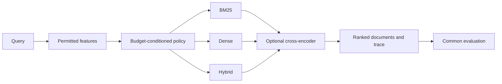

# AtlasIR execution plan

Planning baseline: 16 October 2026. Status: [Day 1 package setup](progress/day-01.md), [Day 2 preservation](DAY02-RUNS.md), [Day 3 data/evaluation](DAY03-DATA.md), and [Day 4 SciFact BM25](progress/day-04.md) are implemented locally. SciFact development inputs and baseline runs are preserved; NFCorpus, Kaggle execution, independent cloud backup and DVC/MLflow integration remain pending.

## Objective and scope

Build AtlasIR: adaptive information retrieval under relevance, latency and compute constraints. Preserve the original sequence:

**BM25 → dense retrieval → hybrid retrieval → fixed neural reranking → adaptive retrieval and reranking → evaluation → report and demonstration.**

The outcome is a defensible research and engineering portfolio: reproducible experiments, useful findings, a small usable search system and a report explaining its limits. A positive result or hiring outcome is not guaranteed.

The central question is whether a query-dependent policy can improve the relevance–latency trade-off compared with strong fixed pipelines, including on domains not used to develop that policy. Selective reranking is the first controller experiment; routing between lexical, dense and hybrid retrieval remains in scope.

## Planning assumptions

| Item | Baseline |
| --- | --- |
| Human effort | 8 weeks × 30 hours = about 240 hours |
| Working rhythm | 5 days/week × 6 hours; weekends available for rest or optional catch-up |
| Main compute | Kaggle notebooks; user reports up to 30 GPU hours/week |
| Secondary compute | Colab when useful; no guaranteed quota assumed |
| GPU training | Pretrained retriever/reranker; train only small routing models |
| Budget | No paid compute or new service subscription assumed |
| Persistence | Git plus DVC-managed artifacts, a durable local copy, and a second verified copy |
| Research language | English for the main controlled experiments |
| French support | Explicit extension after the core release; see below |

GPU time and human work are separate budgets. Thirty available GPU hours is a ceiling, not a target. Start with a short throughput pilot and revise compute estimates without changing the scientific question. Platform limits and hardware are checked at execution time.

## Planning documents

| Document | Use |
| --- | --- |
| [Daily plan](DAILY-PLAN.md) | All 40 workdays, deliverables, dependencies and weekly gates |
| [Research protocol](RESEARCH-PROTOCOL.md) | Datasets, hypotheses, comparison methods, metrics, splits and statistical analysis |
| [Reproducibility](REPRODUCIBILITY.md) | Immutable runs, code/data/model versions, storage, archival and recovery |
| [Compute workflow](COMPUTE.md) | Kaggle/Colab operation, interruption recovery, GPU budget and timing |
| [Reading plan](READING.md) | Verified primary sources, reading order and questions to answer |
| [Experiment proposal template](templates/experiment.md) | Write before a consequential experiment |
| [Decision record template](templates/decision.md) | Record scope, protocol or infrastructure changes |

## Deliverables and completion gates

| Gate | Target | Evidence required |
| --- | --- | --- |
| G1 | End week 1 | BM25 on development queries; metrics validated; clean rerun and artifact restore work |
| G2 | End week 2 | Lexical, dense and hybrid baselines; shared evaluation; recorded runtime conditions |
| G3 | End week 3 | Fixed reranking frontier, oracle opportunity analysis, related-work matrix and feasible compute estimate |
| G4 | End week 4 | Selective reranking compared with fixed depths, random allocation and simple heuristics |
| G5 | End week 5 | Full retrieval/reranking controller tested on development data; final protocol and configurations frozen |
| G6 | End week 6 | Final evaluation, uncertainty, actual end-to-end latency and restoration audit archived |
| G7 | End week 7 | Research report, limitations, generated tables and reviewable release candidate |
| G8 | End week 8 | Usable demo, benchmark explorer, reproducibility instructions, five-minute presentation and release bundle |

If a correctness or reproducibility gate fails, fix it before adding methods. Record a dated revision to the schedule. Do not silently drop dense/hybrid routing to make the deadline. If time becomes insufficient, document what remains and reduce optional work first.

## Architecture to grow into

Use a Python package with separate data, retrieval, reranking, routing, evaluation, experiment and artifact modules. A notebook installs a particular package revision and calls its CLI; it does not contain the authoritative implementation.

The figure shows the query-only variant. A staged variant runs BM25 before routing and must charge that work to every path. Its feature access and cost model are specified separately in the protocol.

Planned interfaces: `Dataset`, `Retriever.search`, `Reranker.rerank`, `Policy.choose`, an evaluator, and a run writer. All methods return stable document IDs and scores through a common schema. Keep concrete implementations behind small adapters. Avoid building a general plugin framework.

## Technology decisions

| Concern | Choice and reason |
| --- | --- |
| Packaging | Python 3.11 target and uv lockfile; validate the available hosted Python interpreter before locking |
| Lexical search | BM25S with explicit BM25 variant and analyzer settings; no Elasticsearch service needed |
| Dense search | Sentence Transformers and E5-small-v2; exact FAISS search first |
| Hybrid | RRF first, then a development-tuned convex score combination as a stronger comparison |
| Reranking | One compact pretrained MS MARCO cross-encoder; fixed depths 20 and 100 |
| Routing | Logistic regression and one small tree model; query-only and post-BM25 features |
| Metrics | ir_measures with explicit provider/measure settings, checked on small fixtures |
| Configurations | Validated YAML, one resolved snapshot per run; no Hydra dependency initially |
| Artifacts | JSON/YAML metadata, Parquet per-query records, compressed TREC ranking files |
| Versioned storage | Git for small files; DVC for larger immutable objects and run bundles |
| Comparison UI | MLflow on a durable local machine, imported from canonical run bundles |
| Testing | pytest and Ruff; meaningful checks for ranking, metrics, splits, archival and recovery |
| CI | Small CPU fixture only; full benchmarks stay on research compute |
| Demo | A small local Python interface, likely Streamlit; static result explorer from archived runs |

Versions will be resolved and pinned during setup. The model and library names above are design choices, not claims to be the newest or strongest available. See the linked official documentation in the reading plan.

## Scope boundaries and extensions

The core includes all three retrieval strategies, fixed and adaptive reranking, held-out-domain evaluation, provenance and a demo. No custom embedding-model training, distributed cluster, vector database service, LLM answer generator or production autoscaling is required to answer the question.

The original French/English ambition remains a second phase because it introduces a separate model, dataset and language-transfer question. After G8, budget 5–10 additional workdays to evaluate a multilingual encoder and reranker on a verified French retrieval dataset such as MIRACL-fr. Use its original corpus and splits, inspect licensing and compute size first, and label any reduced-corpus diagnostic separately. English results do not establish French quality. Do not advertise French support before evaluating it.

Approximate-nearest-neighbor indexing, a second stronger reranker, an upstream contribution and a workshop submission are extensions, not requirements for the initial release.

## Definition of a credible release

- Every reported number points to an archived run and a table-generation recipe.
- A clean checkout can recompute metrics from saved rankings without a GPU.
- A documented recipe can rebuild a small baseline and the full experiments from pinned inputs.
- A fresh run receives a new ID; historical files remain intact.
- Actual online routing latency includes features, routing and chosen retrieval/reranking work.
- Matched-domain and held-out-domain results are distinguished; losses are visible.
- The report compares prior work and makes only supported claims.
- The demo shows documents, the chosen strategy and its trace; static benchmark timing is labeled separately from live timing.

## Initial implementation backlog

Use the daily plan as the dependency order. Create these issue-sized tasks during kickoff; each refers to its protocol and gate:

1. Package, locked environment and fixture CI (day 1).
2. Immutable run writer, schema, export and restore (day 2; G1).
3. Dataset acquisition descriptors, split manifests and leakage guards (day 3).
4. Common ranking/evaluation interface and hand-checked metric fixtures (day 3).
5. Reproducible BM25 baseline (days 4–5; E01).
6. Sharded encoder, exact vector index and dense baseline (days 6–8; E02).
7. RRF/score fusion and comparison importer (days 9–10; E03).
8. Fixed reranking, cost instrumentation and oracle analysis (week 3; E04/E05).
9. Heuristic and learned selective reranking (week 4; E06/E07).
10. Full routing, ablations and final-suite freeze (week 5; E08/E09).
11. Final evaluation, statistics and clean restoration (week 6; E10/E11).
12. Report, demo, benchmark explorer and release candidate (weeks 7–8; E12).

Issue acceptance criteria are the corresponding daily deliverables; no remote issues have been created by this planning work.

## How the plan changes

Use [a decision record](templates/decision.md) when changing datasets, splits, models, metrics, budget semantics or the main hypothesis. Link the superseded design and identify affected experiment IDs. An exploratory failure is a finding, not a reason to erase a run. A methodological bug invalidates affected results and requires corrected runs, with the old records preserved.

No implementation, cloud job, publication or remote repository change is performed by this planning document.
